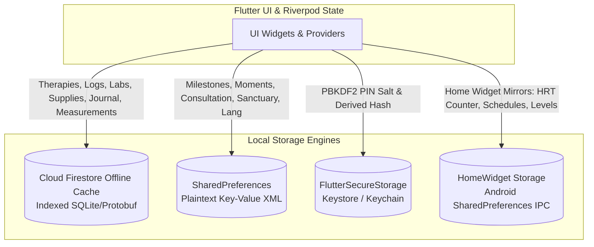
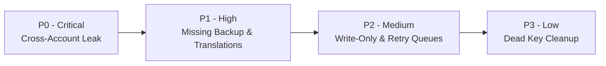

# Lunera — Comprehensive System & Database Cloud Parity Audit Report

**Date of Audit:** 2026-11-24  
**Roles:** Senior Flutter Engineer, Localization Auditor, Firebase & Database Architecture Auditor  
**Repository:** `lunera` (Flutter 3.13.7 / Dart 3.13.7)  
**Status:** Audit & Analysis Only (Strictly zero modifications applied to codebase, databases, or rules)

---

## A. Executive Summary

A comprehensive architectural audit of the **Lunera** codebase was conducted covering localization consistency, local persistence mechanisms, Cloud Firestore integration, synchronization reliability, and security/privacy boundaries.

### Core Findings Overview:
1. **Localization Architecture**:
   - Lunera implements a reactive dictionary-based localization system (`L10n` via `ValueNotifier`, `idStrings` in `lib/l10n_id.dart`).
   - The app has high localization coverage (~91.9%), but exhibits notable **language leakage** with **86 missing translation keys** primarily affecting newly developed modules: *Smart Consultation Prep*, *Care Alerts*, *About & Support*, *HRT Time-Lapse*, and *Medication Administration Routes*.
2. **Local Storage Diversity**:
   - The app utilizes four distinct local storage tiers:
     1. **Cloud Firestore Local Cache** (indexed persistent offline cache for primary therapy data).
     2. **SharedPreferences** (unencrypted XML key-value store on Android/iOS).
     3. **FlutterSecureStorage** (Android Keystore / iOS Keychain for PIN PBKDF2 hash & salt).
     4. **HomeWidget SharedPreferences** (IPC bridge to Android App Widgets).
3. **Cloud Parity & Synchronization Gaps**:
   - 9 core entities (`therapies`, `logs`, `labs`, `supplies`, `targets`, `prefs`, `journal`, `measurements`, `voiceResults`) and 2 metadata documents (`meta/profile`, `meta/security`) are successfully synchronized with Cloud Firestore under `/users/{uid}/`.
   - However, **three major personal health entities** are completely **Local Only** with zero Cloud Firestore representation and are completely omitted from local JSON backups:
     - `TransitionMilestone` (private milestones with locked base64 photos) in `lib/milestones.dart`.
     - `Moment` (scrapbook visual keepsakes with base64 photos) in `lib/moments.dart`.
     - `ConsultationSession` (doctor appointment date, clinic name, clinical questions, and visit notes) in `lib/consultation_prep.dart`.
4. **Critical Cross-Account Privacy Leak (P0)**:
   - When a user signs out via `signOutAll()`, SharedPreferences keys for `TransitionMilestone`, `Moment`, and `ConsultationSession` are **not scoped by `uid` and are NOT deleted**.
   - If another user signs in on the same device, they immediately gain unauthorized visibility into the previous user's private transition photos, scrapbook moments, and clinician consultation notes. Furthermore, `VoiceStore.reconcileWithRemote` will mistakenly upload the previous user's local voice records into the new user's Firestore cloud account.

---

## B. Language Audit

### 1. Localization Metrics
- **Supported Locales**: English (`en`, default) and Indonesian (`id`).
- **Translation Keys in `idStrings`**: 1,241 entries.
- **Active `tr(...)` Invocations in Codebase**: 1,339 calls.
- **Unique Translation Keys Requested**: 1,073 keys.
- **Missing Translation Keys**: **86 keys** (78 explicit `tr(...)` calls + 5 `AdminRoute` presets + 3 `HormonePreset` presets).
- **Dead / Orphan Keys**: **112 keys** in `idStrings` never referenced anywhere in `lib/`.
- **Placeholder / Morphology Mismatches**: **4 keys** (`{0?day|days} ago`, `{0?day|days} late`, `{0?day|days} left`, `{0?day|days} since last dose`).
- **Hardcoded User-Facing Literals**: 6 instances bypassing `tr()`.
- **Localization Coverage**: **91.9%**.

### 2. Primary Language Leakage Areas
- **Smart Consultation Prep (`consultation_prep.dart`, `consultation_prep_page.dart`)**: 49 missing keys. When Indonesian is selected, symptom pattern detection, clinical appointment forms, visit checklists, and auto-generated doctor questions remain entirely in English.
- **Care Alerts & Action Sheets (`care_alerts.dart`, `about_sheet.dart`)**: 10 missing keys. Buttons such as *"Log Dose"*, *"View Supplies"*, and *"View Calendar"* fail to translate.
- **Medication Route Presets (`models.dart`)**: Routes `'Oral'`, `'Sublingual'`, `'Patch'`, `'Gel'`, and `'Other'` are missing from `idStrings`, causing administration routes on dose logs and schedules to display in English even when Indonesian is active.
- **Doctor Report Export (`doctor_report.dart`)**: The section header `Prepared Consultation Questions` in generated PDF and text reports remains English.
- **Detailed line-by-line itemization**: Documented in `LUNERA_LANGUAGE_AUDIT_REPORT.md`.

---

## C. Local Database Inventory

Lunera does not use SQLite, Room, Drift, Isar, or Hive. It relies on a multi-tiered architecture combining Firestore's offline cache, SharedPreferences, FlutterSecureStorage, and Android IPC storage.

### Local Storage Tier Breakdown:



### Complete Local Data Inventory:

| Storage Engine | Key / Collection Name | Model / Entity | Fields & Data Types | Primary Key / Id | Relations | Persistence Type | Service / Repository | Data Classification |
|---|---|---|---|---|---|---|---|---|
| **Firestore Cache** | `users/{uid}/therapies` | `Therapy` | `hormoneId` (String), `name` (String), `dose` (double), `doseUnit` (String), `everyDays` (int), `start` (Timestamp), `supplyId` (String?), `route` (String), `pk` (String?), `rolling` (bool), `injType` (String?), `times` (List\<String\>), `weekdays` (List\<int\>), `monthDay` (int), `kind` (String), `secondary*` (double?, String?) | Auto docId | FK -> `supplies.id` | Permanent | `Repo.therapies()` | User-generated data |
| **Firestore Cache** | `users/{uid}/logs` | `DoseLog` | `therapyId` (String), `at` (Timestamp), `places` (List\<String\>), `dose` (double?), `secondaryDose` (double?), `note` (String?), `wasted` (double?), `dead` (double?), `injType` (String?), `slot` (String?), `usedSupplies` (Map\<String, double\>), `skipped` (bool) | Auto docId | FK -> `therapies.id`, FK -> `supplies.id` | Permanent | `Repo.logs()` | User-generated data |
| **Firestore Cache** | `users/{uid}/labs` | `Lab` | `hormoneId` (String), `at` (Timestamp), `value` (double), `unit` (String), `note` (String?), `cmp` (String?) | Auto docId | None | Permanent | `Repo.labs()` | User-generated data |
| **Firestore Cache** | `users/{uid}/supplies` | `Supply` | `name` (String), `qty` (double), `initial` (double), `perDose` (double), `unitLabel` (String), `expiry` (Timestamp?), `kind` (String), `gtype` (String?), `dosePerUnit` (double?) | Auto docId | None | Permanent | `Repo.supplies()` | User-generated data |
| **Firestore Cache** | `users/{uid}/targets` | `Map<String, List<double>>` | `low` (double), `high` (double) | Hormone Id | None | Permanent | `Repo.targets()` | Application configuration |
| **Firestore Cache** | `users/{uid}/prefs` | `Prefs` | `theme` (String), `units` (Map\<String, String\>), `places` (List\<String\>), `hrtCounter` (bool), `dayStart` (int), `accent` (String), `notify` (bool), `widgetHide` (bool), `locale` (String), `discreetNotify` (String) | Document `'main'` | None | Permanent | `Repo.prefs()` | Application configuration |
| **Firestore Cache** | `users/{uid}/journal` | `JournalEntry` | `at` (Timestamp), `mood` (String?), `body` (Map\<String, String\>), `symptoms` (List\<String\>), `text` (String?) | Auto docId | None | Permanent | `Repo.journal()` | User-generated data |
| **Firestore Cache** | `users/{uid}/measurements` | `BodyMeasurement` | `at` (Timestamp), `unit` (String), `bust` (double?), `underbust` (double?), `waist` (double?), `hips` (double?), `shoulder` (double?), `thigh` (double?), `calf` (double?), `inseam` (double?), `footLength` (double?), `shoeSize` (String?), `weight` (double?), `height` (double?), `note` (String?) | Auto docId | None | Permanent | `Repo.measurements()` | User-generated data |
| **Firestore Cache** | `users/{uid}/voiceResults` | `VoiceTestResult` | `at` (Timestamp), `avgHz` (double), `minHz` (double), `maxHz` (double), `category` (String), `contextTag` (String?) | DocId / Auto docId | None | Permanent | `Repo.voiceResults()` | User-generated data |
| **Firestore Cache** | `users/{uid}/meta/profile` | `ProfileState` | `nickname` (String?), `photo` (String? base64), `updatedAt` (int ms) | Document `'profile'` | None | Permanent | `ProfileController` | User-generated data |
| **Firestore Cache** | `users/{uid}/meta/security` | `LockState` | `enabled` (bool), `salt` (String), `hash` (String), `delayMin` (int), `decoyCalculator` (bool), `updatedAt` (int ms) | Document `'security'` | None | Permanent | `Lock` | Authentication-related data |
| **SharedPreferences** | `body.private_milestones` | `TransitionMilestone` | JSON List: `id` (String), `at` (ISO String), `title` (String), `tag` (String?), `note` (String?), `photoBase64` (String?) | `id` (UUID/timestamp) | None | Permanent (Device-only) | `MilestoneStore` | User-generated data (**LOCAL ONLY**) |
| **SharedPreferences** | `lunera_visual_moments` | `Moment` | JSON List: `id` (String), `at` (ISO String), `title` (String), `note` (String?), `photoBase64` (String?), `category` (String) | `id` (UUID/timestamp) | None | Permanent (Device-only) | `MomentsController` | User-generated data (**LOCAL ONLY**) |
| **SharedPreferences** | `lunera_consultation_session` | `ConsultationSession` | JSON Object: `id` (String), `doctorOrClinic` (String), `scheduledAt` (ISO?), `questions` (List), `checklist` (List), `postVisitNotes` (String), `isCompleted` (bool) | `id` (session_*) | None | Permanent (Device-only) | `ConsultationController` | User-generated data (**LOCAL ONLY**) |
| **SharedPreferences** | `sanctuary.lantern_sparks` & `_last_day` | `LanternState` | `sparks` (int), `lastSparkDay` (String 'YYYY-MM-DD'), `quizBest` (int) | Key string | None | Permanent (Device-only) | `SanctuaryStore` | User-generated data (**LOCAL ONLY**) |
| **SharedPreferences** | `sanctuary.voice_results` | `VoiceTestResult` | JSON List: `id`, `at`, `avgHz`, `minHz`, `maxHz`, `category`, `contextTag` | `id` (v_*) | Mirrors Firestore | Cache & Merge Buffer | `VoiceStore` | User-generated data / Cache |
| **SharedPreferences** | `sanctuary.voice_target_min/max` | `VoiceTargetRange` | `minHz` (double), `maxHz` (double) | Key string | None | Permanent (Device-only) | `VoiceStore` | Application configuration (**LOCAL ONLY**) |
| **SharedPreferences** | `nickname_$uid`, `photo_$uid` | `ProfileState` | `nickname` (String), `photo` (String base64), `profile_updated_$uid` (int ms) | `uid` scoped keys | Scoped to UID | Permanent local mirror | `ProfileController` | User-generated data |
| **SharedPreferences** | `lock.*_$uid` | Lock Settings | `bio` (bool), `decoy` (bool), `delay` (int), `updatedAt` (int), `fails` (int), `until` (int), `tier` (int) | `uid` scoped keys | Scoped to UID | Permanent local state | `Lock` | Authentication-related data |
| **SharedPreferences** | `app.lang` | L10n state | Language code: `'en'` or `'id'` | Key string | None | Permanent | `L10n` | Application configuration |
| **SharedPreferences** | `labs.trough_reminder_at` | Alarm schedule | ISO DateTime string of scheduled trough reminder | Key string | None | Temporary | `AppNotifier` | Temporary / Alarm data |
| **SecureStorage** | `lock.salt_$uid`, `lock.hash_$uid` | Credentials | Salt (base64url, 16 bytes), Hash (`pbkdf2$sha256$60000$...`) | `uid` scoped keys | Keystore/Keychain | Permanent | `Lock` | Authentication-related data |
| **HomeWidget** | `hrt_*`, `sch_*`, `lvl_*` | Widget Display | Text strings, timestamps, base64 chart PNG bytes | Key strings | None | Temporary Cache | `WidgetSync` | Cache data |

---

## D. Cloud Firestore Inventory

### 1. Initialization & Configuration
- **Firebase Initialization**: `Firebase.initializeApp(options: DefaultFirebaseOptions.currentPlatform)` in `lib/main.dart:23`.
- **Firebase Auth**: `FirebaseAuth.instance.authStateChanges()` provides active `User` UID.
- **Offline Persistence**: Enabled by default in mobile/desktop SDKs; verified via `Repo.hasPendingWritesForDocs()`.

### 2. Document Hierarchy & Schema

```
Firestore Root
├── usernames/{name}                       [Top-level: Username lookup directory]
└── users/{uid}/                          [Private User Sandbox]
    ├── therapies/{therapyId}             [Active & historical HRT regimens]
    ├── logs/{logId}                      [Administered / skipped dose history]
    ├── labs/{labId}                      [Bloodwork lab results]
    ├── supplies/{supplyId}               [Medication & supply inventory]
    ├── targets/{hormoneId}               [Custom clinical target ranges]
    ├── prefs/main                        [Cross-device settings & preferences]
    ├── journal/{journalId}               [Daily transition check-ins & mood]
    ├── measurements/{measurementId}      [Anthropometric & sizing records]
    ├── voiceResults/{resultId}           [Acoustic pitch test summaries]
    ├── backups/{backupId}                [Cloud backup metadata catalog]
    ├── backupData/{backupId}             [Encrypted/raw JSON backup blob]
    └── meta/
        ├── profile                       [Display nickname & avatar photo]
        └── security                      [PBKDF2 PIN salt & derived hash]
```

### 3. Security Rules Audit (`firestore.rules`)
```javascript
rules_version = '2';
service cloud.firestore {
  match /databases/{db}/documents {
    // Data pribadi: hanya pemilik akun.
    match /users/{uid}/{document=**} {
      allow read, write: if request.auth != null && request.auth.uid == uid;
    }
    // Pemetaan username -> email, dipakai saat login dengan username.
    match /usernames/{name} {
      allow get: if true;
      allow create: if request.auth != null
        && request.resource.data.keys().hasOnly(['uid', 'email'])
        && request.resource.data.uid == request.auth.uid
        && request.resource.data.email == request.auth.token.email.lower()
        && name.matches('^[a-z0-9_.]{3,20}$');
      allow delete: if request.auth != null && resource.data.uid == request.auth.uid;
    }
  }
}
```
- **Strengths**: Strict owner isolation (`request.auth.uid == uid`) covers all subcollections recursively (`{document=**}`). Username directory allows single-document `get` but strictly forbids `list`, preventing directory scraping.
- **Vulnerabilities / Edge Cases**: No size limitations or schema validation enforced in rules for `users/{uid}`. Client can theoretically upload arbitrary large payloads into subcollections.

---

## E. Local-to-Cloud Mapping & Parity Matrix

| Local Entity / Store | Local Fields | Firestore Collection | Firestore Fields | Status | Parity Notes |
|---|---|---|---|---|---|
| `Therapy` | `id`, `name`, `hormoneId`, `dose`, `doseUnit`, `everyDays`, `start`, `supplyId`, `route`, `pk`, `rolling`, `injType`, `times`, `weekdays`, `monthDay`, `kind`, `secondary*`, `compound*` | `users/{uid}/therapies` | Exact 1:1 match (`start` stored as Timestamp) | **Synced** | Fully bidirectional via reactive streams (`Repo.therapies()`). |
| `DoseLog` | `id`, `therapyId`, `at`, `places`, `dose`, `secondaryDose`, `note`, `wasted`, `dead`, `injType`, `slot`, `usedSupplies`, `skipped` | `users/{uid}/logs` | Exact 1:1 match (`at` stored as Timestamp) | **Synced** | Supply decrements handled atomically via batch writes. Legacy `site` field backwards-compatible in `.from()`. |
| `Lab` | `id`, `hormoneId`, `at`, `value`, `unit`, `note`, `cmp` | `users/{uid}/labs` | Exact 1:1 match (`cmp` optional `<`/`>`) | **Synced** | Fully bidirectional via `Repo.labs()`. |
| `Supply` | `id`, `name`, `qty`, `initial`, `perDose`, `unitLabel`, `expiry`, `kind`, `gtype`, `dosePerUnit` | `users/{uid}/supplies` | Exact 1:1 match (`expiry` stored as Timestamp) | **Synced** | Fully bidirectional via `Repo.supplies()`. |
| `Target Ranges` | `low`, `high` mapped by hormoneId | `users/{uid}/targets` | DocId: hormoneId, fields: `low`, `high` | **Synced** | Fully bidirectional via `Repo.targets()`. |
| `Prefs` | `theme`, `units`, `places`, `hrtCounter`, `dayStart`, `accent`, `notify`, `widgetHide`, `locale`, `discreetNotify` | `users/{uid}/prefs/main` | Exact match with local fields | **Partially Synced** | **Write-Only Anomaly**: `Prefs.locale` is written to Firestore on language change, but is **never read back** on startup/login (`L10n.load()` reads only local SharedPreferences). |
| `JournalEntry` | `id`, `at`, `mood`, `body`, `symptoms`, `text` | `users/{uid}/journal` | Exact 1:1 match (`at` stored as Timestamp) | **Synced** | Fully bidirectional via `Repo.journal()`. |
| `BodyMeasurement` | `id`, `at`, `unit`, `bust`, `underbust`, `waist`, `hips`, `shoulder`, `thigh`, `calf`, `inseam`, `footLength`, `shoeSize`, `weight`, `height`, `note` | `users/{uid}/measurements` | Exact 1:1 match (`at` stored as Timestamp) | **Synced** | Fully bidirectional via `Repo.measurements()`. |
| `VoiceTestResult` | `id`, `at`, `avgHz`, `minHz`, `maxHz`, `category`, `contextTag` | `users/{uid}/voiceResults` | Exact 1:1 match | **Synced** | Reconciled between local SP and Firestore via `VoiceStore.reconcileWithRemote()`. |
| `VoiceTargetRange` | `minHz`, `maxHz` | *None* | *None* | **Local Only** | Custom Hz comfort range is stored strictly in SP (`sanctuary.voice_target_min/max`). Resets to default on new devices. |
| `ProfileState` | `nickname`, `photo` (base64) | `users/{uid}/meta/profile` | `nickname`, `photo`, `updatedAt` | **Synced** | Synced to Firestore, but **omitted from JSON file backup (`exportJson`)**. |
| `LockState` | PBKDF2 salt, hash, delayMin, decoy | `users/{uid}/meta/security` | `enabled`, `salt`, `hash`, `delayMin`, `decoyCalculator`, `updatedAt` | **Synced** | Synced to Firestore, but **omitted from JSON file backup (`exportJson`)**. |
| `TransitionMilestone` | `id`, `at`, `title`, `tag`, `note`, `photoBase64` | *None* | *None* | **Local Only** | Stored in SP `body.private_milestones`. Not in Firestore, not in JSON backup. **High risk of permanent data loss.** |
| `Moment` | `id`, `at`, `title`, `note`, `photoBase64`, `category` | *None* | *None* | **Local Only** | Stored in SP `lunera_visual_moments`. Not in Firestore, not in JSON backup. **High risk of permanent data loss.** |
| `ConsultationSession` | `id`, `doctorOrClinic`, `scheduledAt`, `questions`, `checklist`, `postVisitNotes`, `isCompleted` | *None* | *None* | **Local Only** | Stored in SP `lunera_consultation_session`. Not in Firestore, not in JSON backup. **High risk of permanent data loss.** |
| `Twilight Sanctuary` | `sparks`, `lastSparkDay`, `quizBest` | *None* | *None* | **Local Only** | Stored in SP. Not synced. |
| `Trough Lab Reminder` | `alertAt` (DateTime ISO) | *None* | *None* | **Not Applicable** | Device-specific hardware alarm timestamp (`labs.trough_reminder_at`). |
| `HomeWidget State` | Schedules, HRT counters, level graph PNG | *None* | *None* | **Not Applicable** | Ephemeral IPC mirror for Android system widgets. |
| `CloudBackup Metadata` | `id`, `at`, `count`, `bytes` | `users/{uid}/backups` | Exact 1:1 match | **Cloud Only** | Catalog of cloud backups stored on Firestore. |
| `CloudBackup Data` | `json` string payload | `users/{uid}/backupData` | Exact 1:1 match | **Cloud Only** | Raw backup payload stored on Firestore. |
| `Username Directory` | `uid`, `email` | `usernames/{name}` | Exact 1:1 match | **Cloud Only** | Global lookup directory for username authentication. |

---

## F. Synchronization Reliability & Data Consistency Audit

### 1. Offline-First Architecture & Write Protection
- **`Repo.trackWrite` Mechanism**:
  All primary writes (`therapies`, `logs`, `labs`, `supplies`, `journal`, `measurements`, `voiceResults`) are wrapped in `trackWrite` with:
  - A 4-second timeout.
  - Verification of pending writes in local Firestore cache via `hasPendingWritesForDocs()`.
  - Non-blocking state transition from `SyncStatus.syncing` -> `SyncStatus.queuedOffline` (if unconfirmed but verified locally) -> `SyncStatus.synced` (upon server ACK) -> `SyncStatus.error` (if dropped without queueing).
  - This architecture ensures the UI never hangs on poor cellular networks.
- **Write Retries Deficiency in `Lock`**:
  Unlike `Repo`, security modifications in `lib/lock.dart` (`setPin`, `disable`, `setDecoyCalculator`, `setDelay`) bypass `Repo.trackWrite` and call raw `_doc(uid)?.set(...)` inside a simple `try/catch` block that only logs to console. If a network blip occurs during initial setup on a new device, security state can become desynchronized between local secure storage and Firestore.

### 2. Conflict Handling & Timestamps
- **Timestamps**: Timestamps are normalized using Firestore `Timestamp` objects converted from UTC ISO-8601 strings.
- **Profile Conflict Resolution**: `ProfileController.restoreFromCloud` compares local `profile_updated_$uid` against remote `updatedAt`. If `remoteAt > localAt`, cloud overrides local.
- **Lock Conflict Resolution**: `Lock.applyCloudLockData` compares timestamps and clamps future drift via `clampRemoteUpdatedAtMs()`.
- **Primary Data Collections**: Firestore follows a *last-write-wins* strategy at the document level. Because all documents use unique auto-generated IDs, document collision between different entries is impossible. However, simultaneous offline edits to the exact same therapy on two devices will overwrite each other based on whichever device connects to the server last.

### 3. Missing Data from Backup / Export Mechanism
- **`Repo.exportJson()`**:
  Exports strictly the 9 collections listed in `_cols` (`therapies`, `logs`, `labs`, `supplies`, `targets`, `prefs`, `journal`, `measurements`, `voiceResults`).
- **Omissions in JSON Backup**:
  - `TransitionMilestone` (Milestones & locked photos) -> OMITTED.
  - `Moment` (Scrapbook & milestone photos) -> OMITTED.
  - `ConsultationSession` (Doctor appointment prep & notes) -> OMITTED.
  - `meta/profile` (Profile photo & nickname) -> OMITTED.
  - `meta/security` (PIN configuration) -> OMITTED.
  - If a user relies on the "Export Backup to File" feature to transfer their data to a new device, **all transition photos, moments, consultation records, and profile details will be completely missing from the restored backup.**

### 4. Firestore Write-Only Data
- `Prefs.locale` is written to `users/$uid/prefs/main` whenever the language is changed in Settings (`_save(p.copy(locale: c))`), but upon app initialization, `L10n.load()` strictly reads the local SharedPreferences key `app.lang`. The Firestore field `locale` is never read back, causing multi-device language preferences to fail to synchronize.

---

## G. Security & Privacy Review

### 1. Cross-Account Data Contamination (CRITICAL VULNERABILITY)
- **Vulnerability**: SharedPreferences keys `body.private_milestones`, `lunera_visual_moments`, `lunera_consultation_session`, and `sanctuary.voice_results` are static strings without UID prefixes and are **not purged when `signOutAll()` is executed**.
- **Impact**:
  - If User A logs out on a shared phone and User B logs in, User B has direct visual and read access to User A's private progress photos, scrapbook moments, and clinician consultation notes.
  - In `VoiceStore.reconcileWithRemote`, the reconciliation logic treats existing local records from User A as "missing on remote" for User B, and **automatically uploads User A's voice test results to User B's Firestore cloud database**.
- **Required Remediation**: Prefix all local SharedPreferences keys storing user-generated data with the active `uid` (e.g. `body.private_milestones_$uid`), and explicitly purge them in `signOutAll()`.

### 2. Plaintext Storage of Sensitive Photos
- Transition milestone photos (`TransitionMilestone.photoBase64`) and scrapbook photos (`Moment.photoBase64`) are stored as raw Base64 strings directly inside the unencrypted Android `shared_prefs/FlutterSharedPreferences.xml` file.
- While PIN hashes are protected in Android Keystore / iOS Keychain via `FlutterSecureStorage`, Android's default cloud backup (`android/app/src/main/res/xml/backup_rules.xml`) includes the entire `sharedpref` domain.
- Consequently, unencrypted personal progress photos are uploaded to Google Drive device backups in plaintext, while Keystore keys are excluded.

### 3. Notification Privacy
- Notifications in `lib/notifications.dart` respect the `discreetNotify` setting (`'wellness'`, `'minimal'`, or `'off'`).
- In `'wellness'` mode, medication names are masked to *"Health & Lab Timing ✦"* / *"Upcoming schedule check-in reminder."*, preventing sensitive HRT medication names from appearing on device lock screens.

---

## H. Prioritized Action Plan

Recommendations are categorized by severity based on risk to user privacy, data integrity, and application usability.



### P0 — Critical (Immediate Fix Required)
*Vulnerabilities causing unauthorized data exposure or cross-account data contamination.*

1. **Isolate SharedPreferences by User ID & Purge on Logout**
   - **Component**: `lib/milestones.dart`, `lib/moments.dart`, `lib/consultation_prep.dart`, `lib/voice_pitch.dart`, `lib/ui/auth.dart`.
   - **Impact**: User transition photos, scrapbook moments, clinician consultation notes, and voice records are exposed to subsequent users on the same device and contaminated across accounts.
   - **Recommended Solution**:
     1. Scope storage keys by UID (e.g. `body.private_milestones_$uid`, `lunera_visual_moments_$uid`, `lunera_consultation_$uid`, `sanctuary.voice_results_$uid`).
     2. Update `signOutAll()` in `lib/ui/auth.dart` to explicitly clear these keys or purge the current user's local scoped state.
     3. In `VoiceStore.reconcileWithRemote`, wipe the in-memory `_locallyDeletedIds` and verify current UID before syncing.
   - **Complexity**: Medium.
   - **Dependencies**: None.

---

### P1 — High (Required Before Next Major Release)
*Core data persistence gaps, missing backup coverage, and prominent language leakage.*

2. **Supply Missing 86 Translation Keys in `idStrings`**
   - **Component**: `lib/l10n_id.dart`, `lib/models.dart`.
   - **Impact**: Smart Consultation Prep, Care Alerts, About Sheet, HRT Timelapse, and Medication Administration Routes leak English text when Indonesian is selected.
   - **Recommended Solution**: Add all 86 missing translations identified in `LUNERA_LANGUAGE_AUDIT_REPORT.md` to `idStrings` in `lib/l10n_id.dart`, including `'Oral'`, `'Sublingual'`, `'Patch'`, `'Gel'`, and `'Other'`.
   - **Complexity**: Low.
   - **Dependencies**: None.

3. **Integrate Local-Only Entities into JSON Backup & Cloud Parity**
   - **Component**: `lib/repo.dart` (`_cols`, `exportJson()`, `validate()`, `importData()`), `lib/models.dart`.
   - **Impact**: Users who export their data to a JSON backup file permanently lose all milestones, progress photos, moments, consultation prep, and profile settings upon restore.
   - **Recommended Solution**:
     1. Add `'milestones'`, `'moments'`, `'consultation'`, and `'profile'` to `_cols` and `validate()`.
     2. Update `exportJson()` and `importData()` to include these sections.
     3. Alternatively, provision Firestore subcollections `users/{uid}/milestones`, `users/{uid}/moments`, and `users/{uid}/consultation` so they benefit from dual local/cloud sync.
   - **Complexity**: Medium.
   - **Dependencies**: Item 1.

4. **Secure Milestone & Moment Photo Storage**
   - **Component**: `lib/milestones.dart`, `lib/moments.dart`, `android/app/src/main/res/xml/backup_rules.xml`.
   - **Impact**: Large Base64 image strings bloat SharedPreferences XML and are backed up in plaintext to Google Drive.
   - **Recommended Solution**: Store photos as encrypted binary files in the app's private documents directory (`path_provider`), referencing only the file path in SharedPreferences/Firestore, and exclude unencrypted image directories from cloud backup rules.
   - **Complexity**: High.
   - **Dependencies**: None.

---

### P2 — Medium (Consistency & Reliability Improvements)
*Behavioral inconsistencies, write-only data, and unhandled offline edge cases.*

5. **Synchronize App Language Preference from Cloud (`Prefs.locale`)**
   - **Component**: `lib/main.dart`, `lib/l10n.dart`, `lib/repo.dart`.
   - **Impact**: `Prefs.locale` is written to Firestore on language selection, but is never read back when opening the app or logging in on a new device.
   - **Recommended Solution**: In `main.dart`, listen to `prefsProvider.select((p) => p.value?.locale)` and call `L10n.set(remoteLocale)` if it differs from local `L10n.code`.
   - **Complexity**: Low.
   - **Dependencies**: None.

6. **Wrap `Lock` Cloud Writes in Safe Tracking**
   - **Component**: `lib/lock.dart`.
   - **Impact**: Security PIN changes and delay settings can silently fail to sync to cloud during intermittent network drops without queuing or retries.
   - **Recommended Solution**: Route `_doc(userUid)?.set(...)` in `Lock` through `Repo.trackWrite` or `_safeWrite` to ensure proper offline queue verification and timeout handling.
   - **Complexity**: Low.
   - **Dependencies**: None.

7. **Fix Route Name Matching in History Export**
   - **Component**: `lib/history_export.dart:54`.
   - **Impact**: `t?.route == 'injection'` never evaluates to true because Lunera uses `'inj'` as the route ID, resulting in missing injection types on CSV exports.
   - **Recommended Solution**: Update comparison to `t?.route == 'inj' || t?.route == 'injection'`.
   - **Complexity**: Low.
   - **Dependencies**: None.

---

### P3 — Low (Code Hygiene & Polish)
*Optimization, cleanup, and minor formatting consistency.*

8. **Clean Up 112 Dead Translation Keys in `idStrings`**
   - **Component**: `lib/l10n_id.dart`.
   - **Impact**: Obsolete keys from previous versions bloat the memory footprint of the translation map.
   - **Recommended Solution**: Prune dead keys after verifying deprecation status.
   - **Complexity**: Low.
   - **Dependencies**: None.

9. **Standardize Unit Literals & UI Text Wrappers**
   - **Component**: `lib/ui/sanctuary/voice_pitch_page.dart:1584, 1590`, `lib/ui/body.dart:352`.
   - **Impact**: Minor styling inconsistency where unit labels bypass `tr()`.
   - **Recommended Solution**: Ensure consistent wrapping or document intentional literal exceptions.
   - **Complexity**: Low.
   - **Dependencies**: None.
